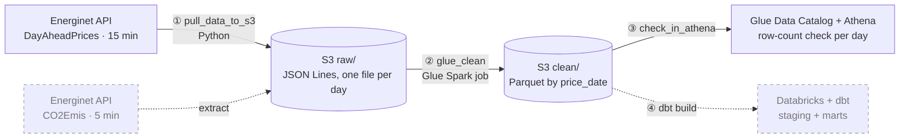

# EnergyPricesETL
 

 
## Project purpose
 
This is a hands-on learning project: an end-to-end data pipeline built from scratch on AWS,
to learn data engineering by doing it rather than only following courses.
It covers the full path a real pipeline takes: extracting from a public API, landing raw data,
cleaning it with Spark, validating it, and orchestrating every step with Airflow.
The infrastructure is managed with Terraform and every change is checked by CI,
with the decisions behind each step written down.
It runs on managed AWS services (S3, Glue, Glue Data Catalog, Athena) with least-privilege IAM roles.
 
The data is Energinet's day-ahead electricity prices for Denmark: the price per
quarter-hour, set the day before, for the two Danish price areas (DK1 West, DK2 East).
It is public, updated daily, and has real-world quirks worth handling properly
(see [The data and its quirks](#the-data-and-its-quirks)).
 
**Day-ahead prices are the first dataset, not the last.** The focus right now is getting the
overall structure right: infrastructure as code, separate environments, automated testing and deployment.
Once that is in place, more datasets will be added on the same structure,
starting with Energinet's CO2 emission data.
 
### What the data is meant to show
 
The pipeline produces a clean, validated table of prices that answers questions like:
 
- **When during the day is electricity expensive or cheap?** The daily shape, with morning
  and evening peaks and the midday dip from solar power.
- **How do prices change across the year?** Monthly averages, and how winter months
  compare with summer months.
- **How do the two price areas differ?** DK1 and DK2 are separate markets
  and do not always move together.
- **How often are prices negative?** Periods when supply is so high that sellers pay buyers to take the power.
With CO2 emissions added, the same model can answer *when is electricity both cheap and clean?*
 
## Architecture
 

 
Solid = running today. Dashed = planned. Steps ①–③ are tasks in one Airflow DAG
(local Docker, daily at 14:00 Danish time, 2 retries).
 

 
- **Schedule:** daily at 14:00 Danish time, fetching *tomorrow's* prices (published around 13:00).
- **Manual runs:** trigger with `start_date` / `end_date` params to backfill a range.
## Infrastructure and CI
 
**Terraform (`infra/`)** manages the AWS side of the pipeline: the data bucket and its public access block,
the Glue job, the Glue script in S3, and the IAM roles and policies for Airflow and Glue.
 
- The resources were first built by hand, then **imported** into Terraform rather than recreated,
  so the running pipeline was never interrupted. `terraform plan` now shows *No changes* against the live account.
- The data bucket has `prevent_destroy`, so Terraform refuses to delete it.
- The Glue script is uploaded by Terraform. A change to `glue/clean_dayaheadprices.py` shows up in
  `terraform plan` and is deployed with `terraform apply`.
- All resources carry `Project` and `Environment` tags through the provider's default tags.
**CI (`.github/workflows/ci.yml`)** runs on every pull request and on every push to `main`. Two jobs run in parallel:
 
| Job | Steps |
|---|---|
| Lint and test (Python) | `ruff check .`, `pytest` |
| Check Terraform | `terraform fmt -check`, `terraform init -backend=false`, `terraform validate` |
 
CI needs no AWS credentials: the tests replace Athena with a fake, and `validate` never calls AWS.
`main` is protected: changes land only through pull requests with both checks green.
 
**Tests (`tests/`)** cover the rules the pipeline depends on:
 
- records are split into files by **Danish** date, not UTC;
- the API date parameters are inclusive and invalid combinations are rejected;
- the data check fails on a missing day and on a wrong row count, and passes on a complete day.
## What the first year of data shows
 
The data covers October 2025 to 20 October 2026: one year of 15-minute prices.
October 2026 is a partial month.
 
### The average price has roughly doubled, but the monthly average hides most of the movement
 

 
On its own, the monthly average looks like a steep climb: from about 0.6 kr/kWh in October 2025
to about 1.25 kr/kWh in October 2026, with most of the rise since July 2026.
Part of the steep look comes from the chart's axis, which does not start at zero.
 

 
Putting the lowest and highest quarter-hour price of each month next to the average changes the picture.
Within any single month, prices swing from around or below zero to 5–12 kr/kWh.
That spread is many times larger than the change in the monthly average over the whole year.
The increase in the average is real, but for anyone who can shift consumption between hours,
*when* electricity is used matters far more than *which month* it is.
 
### Negative prices follow the sun, and were much rarer this October
 

 
Negative prices cluster in spring and summer (March–September), when solar and wind output is high,
and disappear completely from November to February.
October 2025 had around 180 negative quarter-hours; October 2026 has had only about 7 so far.
Even allowing for the month being two-thirds over, that is a large drop.
 
## Repository
 
| Path | What it is |
|---|---|
| `fetch_energinet.py` | Extract: calls the API for a date range, writes one JSON Lines file per Danish day to S3 |
| `glue/clean_dayaheadprices.py` | Glue Spark job: raw JSON → typed, deduplicated Parquet, for one date or `ALL` |
| `athena_checks.py` | Validation: registers the day in the Data Catalog and fails if it is missing or has an unexpected row count |
| `dags/energinet_dayahead.py` | The Airflow DAG: extract → Glue → check |
| `infra/` | Terraform for the bucket, Glue job, Glue script and IAM roles |
| `tests/` | pytest unit tests |
| `.github/workflows/ci.yml` | CI: lint, tests, Terraform checks |
 
## Running it
 
Prerequisites: an AWS account, Terraform ≥ 1.10, Docker Desktop, Python 3.12.
 
1. **Infrastructure:** in `infra/`, run `terraform init`, `terraform plan` and `terraform apply`.
   The Glue Data Catalog database `energinet` and the crawler are not in Terraform yet.
2. **Airflow:** the official Airflow 3 `docker-compose.yaml`, with this repo mounted into the containers
   (`PYTHONPATH=/opt/airflow/repo`), the `dags/` folder as the DAG folder, the AWS config mounted read-only,
   and `S3_BUCKET` set as in `.env.example`.
   Unpause `energinet_dayahead` for the daily schedule, or trigger it with `start_date` / `end_date` to backfill.
3. **Tests:** `pip install -r requirements.txt -r requirements-dev.txt`, then `ruff check .` and `pytest`.
## The data and its quirks
 
| Quirk | What it does to a pipeline | How it is handled |
|---|---|---|
| Two time columns (`TimeUTC`, `TimeDK`) | A UTC day and a Danish day are different 24 hours | Files and partitions are by **Danish** date (`TimeDK`) |
| Daylight-saving days | A day has 23 or 25 hours: 184 or 200 rows instead of 192 | The Athena check accepts 184, 192 and 200 |
| API rate limits (HTTP 429) | Parallel backfill runs get rejected | Errors fail the task; Airflow retries after 30 minutes |
| Tomorrow's prices are published around 13:00 | An earlier run finds no data | The DAG runs at 14:00 and fails loudly on 0 rows |
 
## Design decisions
 
- **Raw is kept as received** (JSON Lines), clean is derived from it, so any day can be reprocessed.
- **Idempotent by design:** one file per Danish day with a fixed name; Glue overwrites only the partitions it
  processes. Re-running a day replaces it instead of duplicating it.
- **One Glue run at a time:** the job allows a single concurrent run, so two runs can never overwrite
  the same partitions at once.
- **Fail loudly:** errors are logged and re-raised, so Airflow marks the task failed and retries.
- **Least privilege:** Airflow runs as an `etl` role that can only use this bucket, this Glue job,
  this catalog table and Athena; the Glue job has its own service role.
- **Imported, not rebuilt:** existing resources were brought under Terraform with import blocks,
  so infrastructure as code was added without downtime.
- **Glue is deliberately overkill** at ~200 rows a day: chosen to learn Spark and the Glue Data Catalog.
  At this volume, a Lambda or Glue Python shell job would be the cheaper choice.
## What broke along the way
 
- **A backfill hit Energinet's rate limit (429)** when three runs called the API at once.
  The task failed loudly and Airflow retried it, as designed. Bulk loads now run one at a time or as one ranged call.
- **Spark could not read JSON arrays** reliably, so the raw format was switched to JSON Lines and all days were reloaded.
- **The bucket was first created in the wrong region** (us-east-1) and recreated in eu-central-1, where the rest of the pipeline runs.
- **The crawler pointed one folder too high** and created a table `clean` with an extra `partition_0` column;
  it now points at the dataset folder.
- **The first version of the Athena check passed on a missing day:** with no rows, there were no "bad" rows either.
  It now also checks that the day exists, and a unit test proves it fails.
- **Glue overwrites failed with a `CancellationException`:** overwriting a partition deletes the old files first,
  and the Glue role had no `s3:DeleteObject`. Found while moving the role into Terraform.
- **The Glue role trusted the wrong service:** its trust policy allowed `s3.amazonaws.com` instead of
  `glue.amazonaws.com`, so the job could not use it. Fixed in Terraform.
- **A manual Glue run overlapped with an Airflow run:** the one-concurrent-run limit rejected the second run
  (`ConcurrentRunsExceededException`) instead of letting both overwrite the same partitions.
  The task was rerun once the first run had finished.
## Operating it
 

 
A normal daily run takes about 1–2 minutes end to end, most of it Glue starting up.
The 22-minute run was a full backfill of all data available from the API.
 
## Next steps
 
- **Environments:** Terraform remote state with locking, a reusable module, and separate dev and prod environments
- **Deployment:** GitHub Actions deploying to AWS through OIDC (no stored keys): plan on every PR, apply on merge
- **Second dataset:** CO2 emissions (`CO2Emis`), with the extractor and Glue job taking the dataset as a parameter
- **Modelling:** dbt on Databricks (staging models, a monthly price mart, tests), run as the last DAG task
- **Checks:** range-aware checks that detect missing days, and partition projection instead of the crawler
 
Claude finished the response
