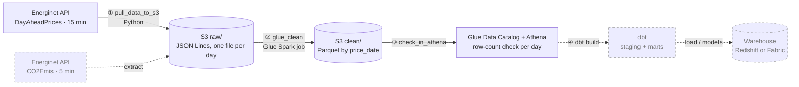

# Project Purpose
This project is intended to validate learning with python for Data Engineering.

It will utilize AWS services, Airflow and Energinet's API.

More details to follow
# EnergyPricesETL

Daily pipeline for Danish day-ahead electricity prices (Energinet, DK1 and DK2, 15-minute resolution).
Airflow pulls the prices from the Energinet API into S3, a Glue Spark job cleans them into Parquet,
and an Athena check validates every day before it counts as done.

## Architecture

```
Energinet API ──► Airflow (local, Docker)
                    │
                    ├─ 1. pull_data_to_s3   → s3://<bucket>/raw/dayaheadprices/date=YYYY-MM-DD/  (JSON Lines, as received)
                    ├─ 2. glue_clean        → s3://<bucket>/clean/dayaheadprices/price_date=YYYY-MM-DD/  (Parquet, typed, deduplicated)
                    └─ 3. check_in_athena   → registers the day in the Glue Data Catalog and checks the row count
```

- **Schedule:** daily at 14:00 Danish time, fetching *tomorrow's* prices (published around 13:00).
- **Manual runs:** trigger with `start_date` / `end_date` params to backfill a range.


Solid = running today. Dashed = planned. Steps ①–④ are tasks in one Airflow DAG
(local Docker, daily at 14:00 Danish time, 2 retries).


## Repository

| Path | What it is |
|---|---|
| `fetch_energinet.py` | Extract: calls the API for a date range, writes one JSON Lines file per Danish day to S3 |
| `athena_checks.py` | Validation: runs Athena queries and fails if a day is missing or has an unexpected row count |
| `dags/energinet_dayahead.py` | The Airflow DAG: extract → Glue → check |
| `glue/clean_dayaheadprices.py` | Glue Spark job: raw JSON → clean Parquet, for one date or `ALL` |

## Running it

Prerequisites: Docker Desktop, an AWS account, Python 3 for local runs.

1. **AWS**: an S3 bucket in `eu-central-1`, the Glue job `clean_dayaheadprices`, a Glue database `energinet`,
   and an IAM role for the pipeline (see *Security* below).
2. **Local run** of a single step:
```
   cp .env.example .env            # set S3_BUCKET
   set AWS_PROFILE=etl
   python fetch_energinet.py 2026-10-20 2026-10-20
   python athena_checks.py 2026-10-20
```
3. **Airflow**: the official `docker-compose.yaml`, with this repo mounted into the containers
   (`PYTHONPATH=/opt/airflow/repo`), the `dags/` folder as the DAG folder, and the AWS config mounted read-only.

## Design decisions

- **Raw is kept as received** (JSON Lines), clean is derived from it, so any day can be reprocessed.
- **Idempotent by design:** one file per Danish day with a fixed name; Glue overwrites only the partitions it
  processes. Re-running a day replaces it instead of duplicating it.
- **Danish date for partitioning** (`TimeDK`), so each partition is exactly one Danish day.
  Normal days have 192 rows (96 quarter-hours × 2 areas); daylight-saving days have 184 or 200.
- **Fail loudly:** errors are logged and re-raised, so Airflow marks the task failed and retries
  (2 retries, 30 min apart). This already caught a real HTTP 429 rate limit during a backfill.
- **Least privilege:** Airflow runs as an `etl` role that can only use this bucket, this Glue job,
  this catalog table and Athena; Glue has its own service role.
- **Glue is deliberately overkill** at ~200 rows a day: chosen to learn Spark and the Glue Data Catalog.
  At this volume, a Lambda or Glue Python shell job would be the cheaper choice.

## Next steps

- dbt models on Athena (staging + monthly price mart)
- Second dataset: CO2 emissions (`CO2Emis`), with the extractor taking the dataset as a parameter
- Range-aware checks (detect missing days), Glue registering its own partitions
- Warehouse layer: Redshift or Microsoft Fabric